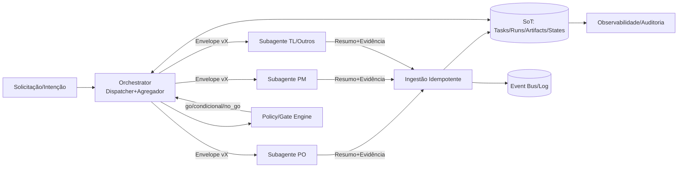

**Classe de autonomia:** B — proposta técnica reversível (artefato documental), sem efeito irreversível, sem aceite de valor (`approved`) e sem alteração de arquitetura aprovada em produção. `[LACUNA]` aprovação humana explícita para promover decisões a Classe C.

## Status
`done` (execução técnica da proposta concluída no escopo solicitado). **Não implica** `completed` (OPS) nem `approved` (PO).

## Conclusão
Propõe-se um SDLC agêntico com **orquestrador dispatcher+agregador** stateless em lógica de domínio, **subagentes especializados** com contratos versionados, **SoT central** para tarefas/artefatos/estados/eventos, ingestão **idempotente** orientada a eventos e gates de qualidade incrementais orientados a evidência. Trade-off assumido: priorizar **rastreabilidade, determinismo e baixo risco operacional** no MVP (simplicidade de componentes, filas/estado explícitos) em detrimento de otimizações avançadas de autonomia/throughput. Stack mínima definida por DEC-018 (2026-11-17): Python 3.12 + pytest + ruff + mypy, sem CI externo; thresholds absolutos (cobertura ≥50%, 0 erros críticos); LangGraph permanece condicional (CR-009-C).

## Evidências principais
| Evidência | Tipo | Observação |
|---|---|---|
| `~/.opencode/references/contrato-resumo-subagentes.md` (lido) | Contrato normativo de agentes | Campos obrigatórios, `status ∈ {done,blocked,partial}`, regras R1–R7, distinção `done/completed/approved`. **sha256 (completo, pinado 2026-11-16):** `163e0aad7654d0a60930e90388afa9b9474ee727f119e94a62337d8321442a60` (prefixo `163e0aad…` confere com DEC-003; sem divergência). |
| `~/.opencode/references/autonomia-e-estados.md` (lido) | Normativo de autonomia/estados | Classes A/B/C, máquina de estados, transições proibidas, taxonomia de falha, 3 strikes / 1 crítico. **sha256 (completo, pinado 2026-11-16):** `776af494ee702cf4d3db8837f2b1c0c23450844f9b54e376a052d7adbc42c78a` (prefixo `776af494…` confere com DEC-003; sem divergência). |
| `~/.agents/skills/engineering-manager/SKILL.md` | `[LACUNA]` | Arquivo não encontrado no ambiente (`~/.agents` inexistente); proposta baseada no papel/guardrails informados no prompt. |
| `~/.agents/standards/contrato-compartilhado.md`, `~/.agents/standards/mapa-sdlc.md` | `[LACUNA]` | Não localizados no ambiente; recomenda-se reconciliar na Fase 0. |
| Stack/infra/repo/CI/gates/restrições | **RESOLVIDO** (DEC-018, 2026-11-17) | Stack mínima definida (Opção B): Python 3.12 + pytest + ruff + mypy, sem CI externo; repo-alvo = este repo (DEC-006(ii)); thresholds absolutos (cobertura ≥50%, 0 erros críticos). LangGraph permanece condicional (CR-009-C). |

## Reconciliação F-ÚNICO-0 (2026-11-16) — mapa de correspondência e cadência

> Nota de reconciliação documental (Classe B, reversível). Este bloco **não apaga o histórico** (F0–F5 e gates G0–G3 permanecem como referência). Ele adiciona a correspondência com a trilha única (`docs/47-roadmap-unico-fundacao-mvp-evolucao-v0.md`) e com o Contrato Canônico v1.0.0-PROPOSTA (`docs/48-contrato-canonico-v1-0-0-proposta-v0.md`). Nenhuma promoção a `approved`/`completed`; status permanece **condicional**.

### Mapeamento de fases (antigas → F-ÚNICO-*)

| Fase antiga (`docs/30`) | Trilha única (`docs/47`) | Observação |
|---|---|---|
| **F0 – Alinhamento & baseline** | **F-ÚNICO-0 – Fundação** | Consolidar SoT documental/convenções; D-V0-05/D-V0-06 APROVADOS E MATERIALIZADOS (DEC-021/DEC-022, 2026-11-17). |
| **F1 – Contratos & modelo de dados** | **F-ÚNICO-0** (validação documental) → **F-ÚNICO-1** (implementação) | Schemas v1.0.0 adotados (D-V0-05, DEC-021, 2026-11-17); validador `docs/schemas/contract-v1.0.0.schema.json`. |
| **F2 – Núcleo dispatcher+agregação (MVP)** | **F-ÚNICO-1 – MVP Controlado** | Desbloqueada por DEC-018 (2026-11-17); D-V0-01 resolvido (R8 mitigado). |
| **F3 – Gates, observabilidade e segurança básica** | **F-ÚNICO-2 – Evolução** | Gates G0→G1 em F-ÚNICO-1; G2→G3 em F-ÚNICO-2. |
| **F4 – Piloto multi-papel & endurecimento** | **F-ÚNICO-2 – Evolução** | Agregação paralela + tratamento de conflitos. |
| **F5 – Evolução contínua** | **F-ÚNICO-2 – Evolução** | Maturação de qualidade/governança. |

**Marcos F-ÚNICO-0 relevantes:** MU-0.1 mapa de divergências registrado (este bloco + `docs/47`/`docs/48`); MU-0.2 despacho D-V0-03/04/05/06 pelo Mantenedor (DEC-009+); MU-0.3 baseline documental v0 reconciliado (ou gaps formalmente registrados). D-V0-03/04/05/06 APROVADOS E MATERIALIZADOS (DEC-019…DEC-022, 2026-11-17); publicação do baseline permanece bloqueada por DEC-008/CR-013 (tracking + publicação).

### Cadência e capacidade (DEC-006)

- A `[PREMISSA-P1]` quinzenal do plano I1 (`docs/20-governanca-pm-plano-baseline-v0.md` §6) está **formalmente substituída** por **"sob demanda, sem SLA formal"** (DEC-006(v), decided_by Lucinei, 2026-11-16). Esta proposta adota a mesma cadência: nenhuma SLA quinzenal vigente; decisões/aceites do Mantenedor único ocorrem sob demanda. `[LACUNA]` SLAs de aprovação permanecem indefinidos até D-V0-02/D-V0-04.
- Risco de capacidade (linha "Capacidade/equipe e janelas de aprovação humana (Classe C)" em `## Riscos e lacunas`) permanece aberto; mitigação = decisão do Mantenedor único sob demanda; **não prometer prazo sem buffer**.

### Evidências e `docs/evidence/` (DEC-005)

- A criação de `docs/evidence/` foi **rejeitada** (DEC-005, Classe C, 2026-11-16). Evidências permanecem **embutidas nos artefatos canônicos** (seções de evidência) ou **referenciadas por link/caminho/hash** (como os hashes completos dos normativos pinados acima). Nenhum diretório `docs/evidence/` é criado por esta reconciliação.
- Normativos externos referenciados por **caminho + sha256 completo** (DEC-003), sem cópia física no repo (evita drift/segunda SoT). Prefixos registrados em DEC-003 (`163e0aad…`, `776af494…`) **conferem** com os arquivos vivos (verificado em 2026-11-16); hashes completos pinados acima. **Nenhuma divergência detectada** — portanto não se registra `[LACUNA]` por divergência de prefixo. `[LACUNA]` residual (DEC-003): o pin exato era "pendente de decisão"; esta reconciliação o executa (Classe B, reversível) sem alterar o conteúdo dos normativos.

### Status honesto

- Este artefato permanece **`condicional`** (execução técnica da proposta concluída no escopo solicitado). **Não implica** `completed` (OPS) nem `approved` (PO). D-V0-03 (DEC-019) e D-V0-04 (DEC-020) APROVADOS E MATERIALIZADOS (2026-11-17); promoção a `approved` exige aceite de valor do PO (execução ≠ valor).

## Arquitetura proposta
### Componentes (alvo)
| Componente | Responsabilidade | SoT? | Notas |
|---|---|---|---|
| **Orchestrator (Dispatcher + Agregador)** | Recebe intenção, planeja/decompõe delegações, roteia para subagentes, consolida resumos/evidências/status, aplica políticas de retry/escalonamento por taxonomia. **Sem implementação direta de domínio.** | Não (coordenação) | Stateless quanto a lógica de negócio; estado de execução persistido no SoT/event log. |
| **Task/Run Registry (SoT)** | Registro canônico de tarefas, runs, delegações, artefatos, estados, evidências, decisões pendentes e lineage (quem/quando/por quê). | **Sim** | Base para rastreabilidade ponta a ponta e auditoria. |
| **Contract & Schema Registry** | Versionamento de envelopes, schemas de tarefa/resumo, mapeamentos de estado e políticas (compatibilidade, depreciação). | **Sim (contratos)** | Imutabilidade por versão; validação na borda. |
| **Event Bus / Log** | Publicação/consumo de eventos de ciclo de vida (created, dispatched, started, progress, emitted, aggregated, blocked, etc.) e trilha append-only. | **Sim (eventos)** | Habilita observabilidade, replay controlado e idempotência por `event_id`. |
| **Idempotency & Dedup Store** | Chaves de deduplicação para ingestão/comandos/reentregas; garante efeito-único onde aplicável. | Suporte ao SoT | R7: reentrega idempotente = novo registro, sem alterar efeitos já persistidos; consumidor deduplica. |
| **Subagentes de domínio** | PO, PM, TL, analistas, implementadores etc.; executam escopo especializado e emitem artefato + Resumo do Subagente. | Não | Contexto fresco por delegação (salvo `sessionID` explícito); sem inferência silenciosa. |
| **Evidence/Artifact Store** | Armazena artefatos, diffs, logs, relatórios, links verificáveis referenciados por evidência. | Suporte ao SoT | Retenção e integridade `[LACUNA: política/infra]`. |
| **Policy/Gate Engine** | Avalia DoD técnico, gates, classe de autonomia, transições permitidas e critérios de escalonamento. | Regras versionadas | “No new errors” relativo a baseline declarada. |
| **Observability & Security Layer** | Métricas, logs estruturados, tracing, alertas; RBAC/segredos/redação/auditoria. | Telemetria | Segurança básica por padrão; hardening conforme `[LACUNA]`. |

### Fluxos principais (dispatcher → subagentes → agregação)
1. **Intake & normalização:** intenção/solicitação registrada no SoT com `request_id`/`task_id`, contexto, critérios de aceite técnicos e lacunas explícitas.
2. **Planejamento/dispatch:** orquestrador gera envelope(s) de delegação versionado(s), define dependências/paralelismo, atribui classe de autonomia esperada e publica eventos `dispatched`.
3. **Execução por subagente:** subagente segue `recebendo → analisando → decidindo → emitindo` (autonomia-e-estados), produz saída de domínio + **Resumo do Subagente** + JSON machine-readable; Classe C vai a `aguardando_aprovacao`.
4. **Ingestão idempotente:** agregador consome emissões por `decision_id`/`run_id`/`idempotency_key`; duplicatas não reexecutam efeitos, mas são registradas/auditadas (novo registro, dedupe no consumidor).
5. **Agregação & reconciliação:** consolida status/evidências/lacunas/decisões pendentes dos entregáveis paralelos (PO/PM/TL), detecta conflitos, atualiza SoT e emite estado agregado.
6. **Gates & decisão de avanço:** Policy/Gate Engine valida evidências mínimas e transições; se aprovado tecnicamente avança fase; se bloqueado/partial escala conforme taxonomia.



### SoT, ingestão/idempotência e rastreabilidade
- **SoT canônico:** Task/Run Registry + Event Log (append-only) + Artifact Store referenciado. Toda transição de estado e evidência aponta a `task_id`, `run_id`, `parent_run_id` (se houver), `schema_version` e `decision_id`.
- **Rastreabilidade ponta a ponta:** `request → task → delegation(s) → run(s) → artifact(s)/evidence → gate result → decisão/aceite`. Lineage obrigatório em cada emissão.
- **Idempotência (onde aplicável):** `idempotency_key = hash(task_id + agent_role + input_fingerprint + schema_version)` para comandos/ingestões; `event_id` único por emissão; retries seguros (at-least-once na entrega, efeito-único no processamento).
- **Reentrega:** conforme R7, novo registro sem mutar efeitos persistidos; agregador deduplica por chave e mantém histórico.

### Eventos/observabilidade
- **Eventos mínimos:** `task.created`, `delegation.dispatched`, `run.started`, `run.emitted`, `run.blocked`, `run.partial`, `run.done`, `aggregation.updated`, `gate.evaluated`, `approval.requested`, `approval.granted|rejected`.
- **Campos de correlação:** `correlation_id/request_id`, `task_id`, `run_id`, `agent`, `classe_autonomia`, `schema_version`, `timestamp`, `status`.
- **Telemetria (MVP):** contagem por status, latência por fase, taxa de retry por taxonomia, fila/pendências de aprovação, falhas de gate; logs estruturados com redação de segredos. `[LACUNA: stack de observabilidade]`.

### Tratamento de falhas/retry por taxonomia
| Tipo | Estratégia | Limite/Ação |
|---|---|---|
| `flaky` | Retry com mesmo input e backoff curto | Máx. 3x; registrar tentativas/evidência. |
| `ambiente` | Diagnóstico/correção de pré-condição, depois retry | Dentro do limite global; escalar se não sanável. |
| `logica` | **Sem retry cego**; análise de causa (arquivo/linha quando aplicável), correção direcionada | Nova execução corretiva registrada. |
| `critico` | **Parada imediata**, contenção, escala humana | 1 ocorrência → bloqueio imediato. |
| `lacuna` | Marcar `[LACUNA]`, emitir `blocked`/`partial`, solicitar dado/decisão | Não inferir; `decisão pendente` explícita. |

Regra global: **3 falhas consecutivas** na mesma validação/tarefa → `bloqueado` + escalonamento humano com evidência; **1 crítica** → parada imediata.

### Segurança básica
- **Controle de acesso:** princípio do menor privilégio por papel/agente; segregação dispatcher vs executores de domínio; aprovações humanas obrigatórias para Classe C.
- **Segredos e dados:** não persistir segredos em artefatos/logs; redação em observabilidade; criptografia em trânsito/repouso `[LACUNA: mecanismos/infra]`.
- **Integridade e auditoria:** trilha append-only de eventos/decisões, artefatos com hash/referência, validação de schema na ingestão.
- **Mudanças sensíveis:** alteração de arquivo selado ou arquitetura aprovada → `no_go`/`aguardando_aprovacao` e escala (conforme guardrails).
- **Supply chain/execução:** permitir lista de ferramentas/ações por agente; sandboxing de execução `[LACUNA: ambiente de execução]`.

## Contratos/Estados
### Envelope de tarefa/delegação (proposta, versionado)
```json
{
  "schema_name": "sdlc.task.delegation",
  "schema_version": "1.0.0",
  "envelope_id": "<ULID>",
  "idempotency_key": "<hash>",
  "correlation": {
    "request_id": "<id>",
    "task_id": "<id>",
    "parent_run_id": "<id|null>"
  },
  "dispatch": {
    "from": "orchestrator",
    "to_agent": "<role>",
    "objective": "<string>",
    "context_refs": ["<path|uri>"],
    "constraints": [],
    "expected_outputs": ["domain_output", "resumo_subagente", "machine_readable_json"],
    "autonomy_class_expected": "A|B|C"
  },
  "acceptance": {
    "technical_dod": [],
    "evidence_required": []
  },
  "timestamps": { "created_at": "<ISO-8601>" }
}
```
*Notas:* validação de schema na borda; compatibilidade retroativa por versão menor quando aditiva; quebra = major + migração. `[LACUNA: registry/tooling]`.

### Contrato de resumo de subagentes (compatível com normativo vigente)
Obrigatório em toda devolução: campos `objetivo`, `ação executada`, `resultado/artefato`, `evidência`, `status (done|blocked|partial)`, `bloqueios/riscos`, `decisão pendente`, `próxima ação recomendada`, conforme R1–R7 de `contrato-resumo-subagentes.md`. Reentrega = novo registro; dedupe por consumidor.

### Mapeamento de estados (execução do agente vs aceite/OPS)
| Camada | Estado/Termo | Dono | Significado | Evidência mínima |
|---|---|---|---|---|
| Execução (agente) | `recebendo/analisando/decidindo/emitindo/aguardando_aprovacao/bloqueado/concluido` | agente/orquestrador | Progresso interno da execução | Transições válidas registradas em evento |
| Resumo (subagente) | `done` | agente | Execução técnica concluída no escopo pedido | Evidência verificável (R3) |
| Resumo (subagente) | `blocked` | agente | Parada por falha/lacuna/rejeição | Bloqueios/riscos + próxima ação (R4) |
| Resumo (subagente) | `partial` | agente | Entrega incompleta com lacunas | Bloqueios/riscos + próxima ação + `[LACUNA]` (R4,R6) |
| Orquestração (OPS) | `completed` | OPS/sistema | Tarefa marcada concluída no board/sistema | Registro de conclusão + rastreio à execução |
| Valor (negócio) | `approved` | PO | Valor aceito | Decision/Acceptance com evidência verificável |
| Gate técnico | `go/condicional/no_go` | TL/Policy | Aptidão técnica para avanço | Resultado de gates + evidências |

**Regras de compatibilidade:** `done` ⇏ `completed` ⇏ `approved`. Classe C nunca conclui como `go/approved` sem aprovação humana explícita registrada; estados terminais de execução não retrocedem (retrabaho = nova execução/run).

## ADRs iniciais
*Convenção canônica (governança documental técnica):* `docs/adr/core/ADR-<NNN>-<slug-kebab>.md` (numeração sequencial global no namespace core, citação por caminho, status `proposed|accepted|superseded|rejected`, data, contexto, decisão, alternativas, trade-offs, consequências, evidências). Convenção confirmada por DEC-020 (D-V0-04, 2026-11-17); ADR-001…ADR-008 promovidos para `accepted`.

| ADR (proposto) | Decisão recomendada | Alternativas consideradas | Trade-offs / Consequências |
|---|---|---|---|
| ADR-A: Orquestrador como Dispatcher+Agregador (sem domínio) | Separar coordenação de execução de domínio; subagentes emitem contratos padronizados. | (1) Orquestrador monolítico com lógica de domínio; (2) Coreografia pura sem agregador. | +Clareza de responsabilidades, testabilidade e auditabilidade. −Overhead de coordenação/latência; exige contratos fortes. |
| ADR-B: SoT central + Event Log append-only | Persistir tasks/runs/artefatos/estados em registry canônico e eventos imutáveis para lineage. | (1) Estado distribuído por agente; (2) Apenas logs sem registry estruturado. | +Rastreabilidade, replay controlado, auditoria. −Complexidade operacional e custo de storage `[LACUNA]`. |
| ADR-C: Idempotência e ingestão at-least-once com dedupe | Chaves de idempotência/event_id, reentrega como novo registro (R7), efeitos únicos no processamento. | (1) Exactly-once fim-a-fim; (2) Best-effort sem dedupe. | +Resiliência a retries/reentregas. −Necessita store de dedupe e disciplina de chaves. |
| ADR-D: Contratos versionados (envelope + resumo + JSON) com validação na borda | Schema registry, versionamento semântico de contratos, compatibilidade aditiva em minor. | (1) Contratos implícitos/ad-hoc; (2) Breaking changes sem versionamento. | +Evolução segura e interoperabilidade. −Governança e migração de versões. |
| ADR-E: Modelo de estados e autonomia (execução vs aceite, A/B/C) | Adotar taxonomia done/completed/approved, classes A/B/C e transições proibidas como política executável. | (1) Estado único “done”; (2) Aprovação implícita. | +Semântica clara e controle de risco (Classe C). −Mais etapas de aprovação/escalonamento. |
| ADR-F: Qualidade incremental por gates e evidência (“no new errors”) | Gates mínimos no MVP, baseline explícita, endurecimento progressivo por fase. | (1) Gate rígido completo desde o início; (2) Sem gates formais. | +Baixo risco de adoção e feedback rápido. −Risco residual até maturação; depende de baseline `[LACUNA]`. |
| ADR-G: Observabilidade e segurança mínima by design | Logs estruturados correlacionáveis, métricas de fluxo, RBAC/segredos/redação desde MVP. | (1) Observabilidade tardia; (2) Segurança apenas perimetral. | +Detecção precoce de falhas e conformidade básica. −Custo inicial e dependências de infra `[LACUNA]`. |

## Qualidade e Gates
### DoD técnico (incremental, MVP)
- Envelope e resumo válidos contra `schema_version` declarada; campos obrigatórios presentes.
- Evidência verificável anexada/referenciada para `done`; `[LACUNA]` explícita quando ausente (nunca `done` sem evidência).
- Rastreabilidade: `request/task/run/agent` correlacionáveis; artefatos registrados no SoT/store.
- Sem regressão introduzida nos gates aplicáveis da fase (**no new errors** vs baseline declarada).
- Decisões Classe C registradas como `aguardando_aprovacao`/bloqueadas até aprovação humana.

### Estratégia de gates (incremental)
| Fase | Gates obrigatórios | Evidências mínimas | Critério “no new errors”/baseline |
|---|---|---|---|
| **G0 – Fundacional** | Validação de schema/contrato (envelope+resumo+JSON), lint/format de artefatos normativos, checagem de links/paths de evidência. | Relatório de validação, logs de verificação, hashes/refs de artefatos. | Baseline: zero erros de schema/contrato na emissão atual. |
| **G1 – MVP operacional** | G0 + testes automatizados do núcleo de orquestração/ingestão/idempotência, smoke de fluxo dispatcher→agregação, verificação de correlação/lineage. | Resultados de testes, traces/logs correlacionados, amostras de dedupe. | Baseline inicial congelada na primeira execução verde; novas falhas = bloqueio; legadas apenas se registradas. `[LACUNA: ferramenta/CI]` |
| **G2 – Endurecimento** | G1 + cobertura mínima (threshold absoluto ≥50%, DEC-018), análise estática/tipos (0 erros críticos), SAST/dependency scan básico, SLOs iniciais de execução/retry. | Relatórios de cobertura/estática/segurança, métricas de fluxo. | “No new errors” em lint/tipos/segurança vs baseline versionada; cobertura ≥ 50% (threshold absoluto DEC-018) (valor medido). |
| **G3 – Escala/governança** | G2 + gates de performance/carga (se aplicável), revisão de ADRs para mudanças significativas, auditoria periódica de trilhas. | Dashboards, relatórios de auditoria, ADRs aceitos. | Regressões de SLO/gates tratadas como `condicional`/`no_go` conforme impacto. |

`[LACUNA]`: ferramentas específicas de lint/test/CI e repositório-alvo resolvidos parcialmente por DEC-018 (stack mínima Python 3.12 + pytest + ruff + mypy, sem CI externo; repo-alvo = este repo). Thresholds numéricos agora absolutos por DEC-018 (cobertura ≥50%, 0 erros críticos); parametrização permanece para projetos-alvo futuros.

## Plano técnico incremental
| Fase | Objetivo | Entregáveis | Dependências | Critérios de aceite técnicos | Risco principal |
|---|---|---|---|---|---|
| **F0 – Alinhamento & baseline** | Consolidar SoT documental e convenções | Glossário de estados, convenção ADR canônica, inventário de lacunas, reconciliação de contratos existentes | Acesso a docs/padrões do ecossistema `[LACUNA]` | Contratos de referência identificados; lacunas registradas; sem inferência silenciosa | Ambiguidade de normas existentes |
| **F1 – Contratos & modelo de dados** | Formalizar envelopes, resumo, estados e eventos | Schemas v1.0.0, validador, mapeamento de estados, política de idempotência | F0 | Validação automática passa em casos válidos/inválidos; lineage definido | Quebra de compatibilidade futura |
| **F2 – Núcleo dispatcher+agregação (MVP)** | Fluxo ponta a ponta mínimo com 1-2 papéis | Orquestrador (dispatch/aggregate), ingestão idempotente, persistência SoT mínima, emissão de eventos | F1 | Delegação→execução→agregação rastreável; dedupe comprovado; resumos conformes | Complexidade de integração `[LACUNA infra]` |
| **F3 – Gates, observabilidade e segurança básica** | Confiabilidade operacional mínima | Policy/Gate Engine G0/G1, logs/traces/métricas, RBAC/segredos/redação básicos | F2 | Gates bloqueiam não conformidades; telemetria correlacionável; sem segredos em logs | Cobertura observável insuficiente |
| **F4 – Piloto multi-papel & endurecimento** | Reconciliar PO/PM/TL em paralelo | Fluxo paralelo, tratamento de conflitos, retries por taxonomia, runbooks de incidente/escalonamento | F3 | Entregáveis paralelos agregados com decisões pendentes explícitas; 3-strikes/1-crítico operando | Coordenação e carga cognitiva |
| **F5 – Evolução contínua** | Amadurecer qualidade e governança | Gates G2/G3, ADRs operacionais, métricas de capacidade/dívida | F4, decisões de stack/CI `[LACUNA]` | Tendência de qualidade estável; decisões significativas em ADR | Dívida técnica acumulada |

**O que pode ser implementado primeiro com baixo risco (MVP técnico):** F0→F1 focados em **artefatos documentais e validação de contratos** (schemas, exemplos, validador offline, convenção de estados/ADRs) — alto valor de alinhamento, reversível (Classe B), sem dependência de infra produtiva e sem efeitos irreversíveis.

## Riscos e lacunas
| Item | Tipo | Impacto | Mitigação / Próximo passo |
|---|---|---|---|
| Stack, infra, repositório-alvo, CI/ferramentas de gates, restrições de ambiente | **RESOLVIDO** (DEC-018, 2026-11-17) | Stack mínima definida (Python 3.12 + pytest + ruff + mypy, sem CI externo); repo-alvo = este repo; thresholds absolutos (cobertura ≥50%, 0 erros críticos). LangGraph permanece condicional (CR-009-C). | Baseline técnica registrada em DEC-018; ADRs correspondentes a serem atualizados quando aprovados (Classe C). |
| `~/.agents/skills/engineering-manager/SKILL.md` e padrões compartilhados ausentes no ambiente | `[LACUNA]` | Possível desalinhamento com regras encapsuladas do papel/ecossistema | Localizar/restaurar skill e `contrato-compartilhado.md`/`mapa-sdlc.md`; reconciliar proposta. |
| Numeração/convenção canônica de ADRs em reconciliação (ex.: existência externa conflitante) | Risco/Lacuna | Colisão ou perda de rastreabilidade documental | Não atribuir número nesta fase; criar registry/índice canônico em F0. |
| Ambiguidade de ownership de estados (OPS vs agente vs PO) na implantação | Risco | Transições inválidas, falso “approved/completed” | Implementar Policy/Gate Engine com transições proibidas e auditoria. |
| Idempotência mal definida em integrações externas | Risco | Duplicação de efeitos ou perda de eventos | Padronizar `idempotency_key/event_id`, testes de dedupe e reprocessamento controlado. |
| Segurança/segredos em observabilidade e artefatos | Risco | Exposição de dados sensíveis | Redação por padrão, revisão de políticas, scans quando CI disponível. |
| Capacidade/equipe e janelas de aprovação humana (Classe C) | `[LACUNA]` | Gargalos em fluxo e atraso de decisões | Planejar RACI, SLAs de aprovação e capacidade (input PM). |

## Próximos passos
1. **F0 (baixo risco, Classe B):** formalizar glossário de estados, convenção ADR canônica e inventário de lacunas; reconciliar com `contrato-compartilhado.md`/`mapa-sdlc.md` quando disponíveis. — Dono: TL/Arquitetura — Prazo: `[LACUNA]`
2. **F1 (baixo risco, Classe B):** especificar e validar schemas v1.0.0 (envelope, resumo, evento, mapeamento de estados) com exemplos válidos/inválidos. — Dono: TL + PO/PM (alinhamento de campos) — Prazo: `[LACUNA]`
3. **Decisão de baseline técnica (Classe C):** RESOLVIDA por DEC-018 (2026-11-17) — stack mínima Python 3.12 + pytest + ruff + mypy, sem CI externo; thresholds absolutos (cobertura ≥50%, 0 erros críticos); publicar ADRs correspondentes com `adr_ref` canônico quando aprovados. — Dono: TL (recomenda) / Aprovação: humana/arquitetura — Prazo: F0/F1.
4. **F2 piloto:** implementar núcleo dispatcher→agregação com ingestão idempotente e rastreabilidade ponta a ponta em ambiente controlado. — Dono: Engenharia — Prazo: `[LACUNA]`
5. **Gate readiness:** configurar G0/G1 no CI alvo e estabelecer baseline “no new errors” versionada. — Dono: TL/DevEx — Prazo: `[LACUNA]`

```json
{
  "decision_id": "[LACUNA: ULID não gerado no ambiente de execução]",
  "papel": "tech-lead",
  "classe_autonomia": "B",
  "decision_type": "arquitetura",
  "adr_ref": "none",
  "status": "condicional",
  "evidencia": [
    "~/.opencode/references/contrato-resumo-subagentes.md (lido) — sha256 163e0aad7654d0a60930e90388afa9b9474ee727f119e94a62337d8321442a60",
    "~/.opencode/references/autonomia-e-estados.md (lido) — sha256 776af494ee702cf4d3db8837f2b1c0c23450844f9b54e376a052d7adbc42c78a",
    "technical_context: stack/infra/repositório/CI/gates/restrições = [LACUNA]",
    "docs/47-roadmap-unico-fundacao-mvp-evolucao-v0.md (lido 2026-11-16)",
    "docs/48-contrato-canonico-v1-0-0-proposta-v0.md (lido 2026-11-16)",
    "docs/DECISIONS.md (DEC-003/DEC-005/DEC-006/DEC-008, lido 2026-11-16)"
  ],
  "premissas_validadas": [
    "Orquestrador atua como dispatcher + agregador, sem implementação direta de domínio",
    "Resumo de subagentes deve seguir contrato normativo com status done|blocked|partial e evidência verificável",
    "Reentrega idempotente = novo registro; dedupe no consumidor (R7)",
    "Classe C exige aprovação humana explícita; nenhuma promoção a approved/completed implícita"
  ],
  "lacunas": [
    "Skill de apoio ~/.agents/skills/engineering-manager/SKILL.md não encontrada",
    "Padrões compartilhados ~/.agents/standards/contrato-compartilhado.md e mapa-sdlc.md não encontrados",
    "Stack/infra/CI/gates RESOLVIDOS por DEC-018 (2026-11-17): Python 3.12 + pytest + ruff + mypy, sem CI externo; repo-alvo = este repo; thresholds absolutos (cobertura ≥50%, 0 erros críticos). LangGraph permanece condicional (CR-009-C)",
    "Convenção/numeração canônica de ADRs a reconciliar (nenhum adr_ref atribuído)",
    "Thresholds definidos por DEC-018 (cobertura ≥50%, 0 erros críticos); parametrização permanece para projetos-alvo futuros",
    "SLAs de aprovação/cadência não definidos — DEC-006(v) substitui premissa quinzenal por 'sob demanda, sem SLA formal' (input PM/D-V0-02); D-V0-04 aprovado (DEC-020, 2026-11-17)"
  ],
  "proximas_acoes": [
    { "acao": "Executar F0: consolidar convenções documentais, glossário de estados e registry canônico de ADRs", "dono": "Tech Lead/Arquitetura" },
    { "acao": "Executar F1: definir e validar schemas versionados (envelope, resumo, eventos, estados)", "dono": "Tech Lead + PO/PM" },
    { "acao": "Definir baseline técnica (stack/infra/CI/gates) e aprovar ADRs iniciais", "dono": "Tech Lead (proposta) / Aprovação humana (Classe C)" }
  ],
  "schema_version": "1.0"
}
```

## Resumo do Subagente
- objetivo: Produzir proposta técnica/arquitetural do zero para um sistema SDLC agêntico robusto e eficiente (orquestrador dispatcher+agregador), com contratos, estados, ADRs, gates e plano incremental.
- ação executada: Leitura dos contratos normativos disponíveis (`contrato-resumo-subagentes.md`, `autonomia-e-estados.md`); verificação de existência de skill/padrões referenciados; elaboração da arquitetura alvo, contratos versionados, mapeamento de estados, ADRs iniciais, estratégia de qualidade/gates e plano técnico incremental com riscos e lacunas explícitas.
- resultado/artefato: Proposta técnica estruturada neste retorno (Arquitetura, Contratos/Estados, ADRs iniciais, Qualidade e Gates, Plano incremental, Riscos/lacunas, Próximos passos) + JSON machine-readable.
- evidência: `~/.opencode/references/contrato-resumo-subagentes.md` (lido); `~/.opencode/references/autonomia-e-estados.md` (lido); ausência confirmada de `~/.agents/skills/engineering-manager/SKILL.md` e `~/.agents/standards/contrato-compartilhado.md` no ambiente; `[LACUNA]` para stack/infra/repo/CI/gates.
- status: done
- bloqueios/riscos: `[LACUNA]` de stack/infra/repositório-alvo/CI/gates e restrições de ambiente; skill/padrões compartilhados não localizados; numeração canônica de ADRs pendente de reconciliação; promoção de decisões arquiteturais/aceite requer Classe C com aprovação humana.
- decisão pendente: Aprovação humana das decisões arquiteturais e da baseline técnica (Classe C) para atribuição/aceite de ADRs e avanço além de artefatos reversíveis; definição de ferramentas/thresholds de CI e do `pyproject.toml` do projeto-alvo quando aplicável.
- próxima ação recomendada: Executar F0/F1 (baixo risco, Classe B) para consolidar convenções e schemas versionados; em paralelo, coletar baseline técnica (stack/infra/CI) e submeter ADRs iniciais à aprovação humana (Classe C).
